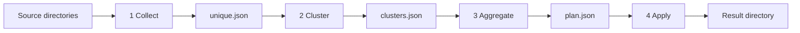

# Photo library repair

`repair_library.py` walks photo directories and produces one file per picture. Exact copies are collapsed first. Near-duplicates are grouped by perceptual hash. Each group then becomes one image: the best pixels, with capture time, GPS, and camera tags chosen from the members. Files stay where they are until the last step, which moves that one image into the result directory.

`cluster_groups.ipynb` is the earlier Czkawka and UMAP notebook. `investigate_conflicts.ipynb` reviews groups this pipeline marks as conflicts and can rerun clustering into a separate work directory. A trial never calls apply, so it does not move files.

## Setup

Python 3 and [ExifTool](https://exiftool.org/) are required. ExifTool is the external program that reads and writes metadata.

```text
python3 -m pip install -r requirements.txt
```

## Pipeline



```text
python repair_library.py collect --dir PHOTO --dir MORE --work work
python repair_library.py cluster --work work --algorithm hdbscan --max-hamming 32
python repair_library.py cluster --work work --algorithm optics --optics-max-eps 64
python repair_library.py aggregate --work work
python repair_library.py aggregate --work work --conflicts-only
python repair_library.py apply --work work --result repaired
python repair_library.py all --dir PHOTO --work work --result repaired
python repair_library.py --self-test
```

`--dry-run` on `all` or `apply` prints the moves and does not perform them. Apply refuses to overwrite a file that is already in the result directory.

## Collection

Each directory is walked recursively. A file is kept when its header is JPEG, PNG, GIF, WebP, TIFF, or HEIC. The filename suffix is not trusted.

Byte-identical files share a SHA-256 hash. One survivor is kept: the earliest modification time. The other copies stay on disk and are listed under `dropped` in `work/unique.json`. They are not passed to clustering and they are not a metadata conflict.

## Clustering

Each survivor gets a 256-bit perceptual hash (`imagehash.phash`, `hash_size=16`) after EXIF orientation is applied, so a sideways file matches the same picture stored already rotated. Hashes are cached in `work/phash.json`. HEIC needs `pillow-heif`.

`--algorithm` is `hdbscan` (the default) or `optics`. Both use Hamming distance. Shared flags are `--min-cluster-size`, `--min-samples`, and `--max-hamming` (default 32 bits). After the density algorithm, members connected by more than `--max-hamming` bits are split, so a cluster means the hashes are actually close. Noise points each become their own cluster. A single image is a normal result.

HDBSCAN flags: `--hdbscan-epsilon` (hash bits), `--hdbscan-method` (`eom` or `leaf`), `--allow-single-cluster`.

OPTICS flags: `--optics-max-eps` (hash bits), `--optics-cluster-method` (`xi` or `dbscan`), `--optics-xi`, `--optics-eps` (hash bits, used by DBSCAN extraction).

`work/clusters.json` lists each group with `max_hamming`, the medoid path, and members (path, size, width, height, perceptual hash, Hamming distance to the medoid). `work/clustering.json` stores the parameters used for that run.

## Aggregation

ExifTool reads every member. One plan is written per cluster, including a one-image cluster. Nothing is moved. The plan is `work/plan.json`.

`--conflicts-only` reruns that plan for groups whose `conflicts` list is not empty. Every other group is copied from the existing `plan.json` unchanged. Use it after changing conflict rules so only the groups that were conflicts are read and planned again. Clustering is not repeated. A group that no longer conflicts is saved with an empty `conflicts` list.

- **Pixels.** Largest width times height. Equal resolution prefers a better encoding: HEIC, then JPEG, then TIFF, PNG, WebP, and GIF. File size breaks the remaining ties. This file is the one apply moves.
- **Name.** Shortest basename. Equal lengths use the alphabetically earlier name. The extension is taken from the file bytes so ExifTool can write it.
- **Capture time, GPS, and camera tags.** Chosen as described under conflicts. Tags are copied from the selected member onto the moved pixel file.

A conflict does not drop the group. The group is still emitted, and apply still moves its pixel file. `conflicts` on the plan, and later `result/report.json`, records why the metadata was not unanimous.

## How conflicts are handled

Members of a cluster are treated as the same picture. Two checks can add a conflict. They are independent, so one group can carry both.

### Capture time

The only capture clock is EXIF `DateTimeOriginal`. `CreateDate`, XMP dates, IPTC dates, and file creation time are not capture times. The value stored on the result is the local clock (`YYYY:MM:DD HH:MM:SS`).

`OffsetTimeOriginal` is applied when comparing two `DateTimeOriginal` values. An offset written on the timestamp itself (`+10:00`, `+1000`, or `Z`) is used too. If one file has a zone and the other has only a bare clock, the two wall clocks are compared.

Camera data means any of make, model, lens, focal length, aperture, exposure time, ISO, or the other camera fields read by `camera_score`. A camera file is assumed to hold the right capture time.

`--max-capture-disagreement` sets the allowed gap. The default is `1d`. `12h`, `90s`, and a bare number of seconds are also accepted.

- **Two or more files have camera data and `DateTimeOriginal`.** Their capture times are compared. A gap larger than `--max-capture-disagreement` adds `capture times disagree`. Inside that limit, the oldest capture time is kept and the group is not a capture-time conflict. A later time on a file without camera data does not enter this comparison.
- **No file has camera data.** The earliest `DateTimeOriginal` is kept. The size of the gap does not matter, and the group is not a capture-time conflict.
- **Camera data is present but none of those files have `DateTimeOriginal`.** No capture time is copied. Creation time is not used instead.

Camera tags are copied from the file that supplied the chosen camera capture time. If no camera file has `DateTimeOriginal`, tags come from the camera file with the most camera fields.

### GPS

A position is read from GPS latitude and longitude. `(0, 0)` is ignored. A file with no position does not vote.

If any two positions are more than 100 m apart, the group gets `gps positions disagree by more than 100 m` and no GPS tags are copied. If every position is within 100 m, the smallest coordinates are copied: the smallest latitude, then the smallest longitude.

Description, artist, copyright, keywords, and rating are copied from the other members and are not conflict checks.

## Apply

Apply moves the pixel source into the result directory under the planned name, then writes the chosen capture time, GPS, and camera tags onto that file with ExifTool. Other cluster members and the exact copies dropped during collection stay in the source directories.

`result/report.json` lists the output path, the source files, and any conflicts.

## Reviewing conflicts

Open `investigate_conflicts.ipynb` with `work` pointing at a directory that already has `clusters.json` and `plan.json`. The notebook lists groups whose `conflicts` list is not empty, shows thumbnails, and reads capture time, GPS, and camera fields for the selected group.

To try other clustering parameters, edit `PARAMETERS` and run the trial cells. They copy `unique.json` and `phash.json` into `work-trial`, then cluster and aggregate there. The original `work` directory and the source photos are left unchanged.
