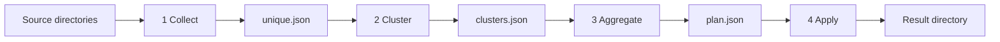

# Photo library repair

`repair_library.py` walks photo directories and produces one file per picture. The perceptual hash is the identity of a picture, so identical pictures are collapsed first and near-duplicates are grouped with that same hash. Each group then becomes one image: the best pixels, with capture time, GPS, and camera tags chosen from the members. Files stay where they are until the last step, which copies that one image into the result directory. `--move` moves it instead. `increment` adds new photos to a library that already has a plan.

The notebooks in `notebooks/` inspect clustering. What each one reads and writes is described under [Notebooks](#notebooks).

Code lives in `photo_repair/`. `repair_library.py`, `merge_group_metadata.py`, and `embed_group.py` are the command-line entry points. Photo libraries, pipeline `work/` directories, and JSON dumps of image paths are gitignored.

## Setup

Python 3 and [ExifTool](https://exiftool.org/) are required. ExifTool is the external program that reads and writes metadata.

```text
python3 -m pip install -r requirements.txt
```

## Pipeline



```text
python repair_library.py collect --dir PHOTO --dir MORE --work work --min-size 100
python repair_library.py missing --library-work work --dir INBOX --dir MORE --work work-new
python repair_library.py increment --library-work work --dir INBOX --work work-increment --max-hamming 12
python repair_library.py cluster --work work --algorithm hdbscan --max-hamming 32
python repair_library.py cluster --work work --algorithm optics --optics-max-eps 64
python repair_library.py aggregate --work work
python repair_library.py aggregate --work work --conflicts-only
python repair_library.py apply --work work --result repaired
python repair_library.py apply --work work --result repaired --move
python repair_library.py all --dir PHOTO --work work --result repaired
python repair_library.py --self-test
```

`--dry-run` on `all` or `apply` prints each copy, or each move when `--move` is set, and does not perform it. Apply refuses to overwrite a file that is already in the result directory.

## Collection

Each directory is walked recursively. A file is kept when its header is JPEG, PNG, GIF, WebP, TIFF, or HEIC. The filename suffix is not trusted. `--min-size 100` ignores images smaller than 100 kB, which leaves out thumbnails and other clutter. The default is 0, so every image is kept. Scanning and perceptual hashing run on several threads. Each path is visited once, and a hard-linked file is decoded once.

The identity of a picture is its 256-bit perceptual hash after EXIF orientation. The same hash and the same file size keep the earliest path. A later copy stays on disk and is listed under `dropped` in `work/unique.json`. A different file size is kept, so aggregation can still choose the larger pixels. Dropped files are not passed to clustering and they are not a metadata conflict.

## Missing from a reference library

`missing` compares new directories with a library that already has `clusters.json`. `--library-work` is that library and is only read. Each `--dir` is searched for images. Distance 0 at the same file size is already present. Distance 1 through `--max-hamming` is written to `matched.json` as a join to that library group. `survivors` are the pictures farther away. `--min-size` applies to the new directories.

`increment` first groups the incoming files among themselves. Two new files within `--max-hamming` of each other, or connected by a chain of such files, are one picture. Exact copies of a library file are already present. If any file in an incoming picture is within `--max-hamming` of a library group, the rest of that picture joins the same group and the group is aggregated again. A picture that does not meet the library becomes one new group. Untouched library rows are marked `skip`, so a later apply copies only new result files and replaces a result file whose chosen pixels changed.

```text
python repair_library.py increment --library-work work --dir INBOX --work work-increment --max-hamming 12
python repair_library.py apply --work work-increment --result LIBRARY
```

## Clustering

Clustering uses the same 256-bit perceptual hash (`imagehash.phash`, `hash_size=16`). JPEG is decoded as a reduced preview before the hash; the stored width and height stay the full displayed size. A hash is cached in `phash.json` by path, size, and modification time, and the cache is written when the scan finishes. HEIC needs `pillow-heif`.

`--algorithm` is `hdbscan` (the default) or `optics`. Both use Hamming distance. Shared flags are `--min-cluster-size`, `--min-samples`, and `--max-hamming` (default 32 bits). After the density algorithm, members connected by more than `--max-hamming` bits are split, so a cluster means the hashes are actually close. Noise points each become their own cluster. A single image is a normal result.

HDBSCAN flags: `--hdbscan-epsilon` (hash bits), `--hdbscan-method` (`eom` or `leaf`), `--allow-single-cluster`.

OPTICS flags: `--optics-max-eps` (hash bits), `--optics-cluster-method` (`xi` or `dbscan`), `--optics-xi`, `--optics-eps` (hash bits, used by DBSCAN extraction).

`work/clusters.json` lists each group with `max_hamming`, the medoid path, and members (path, size, width, height, perceptual hash, Hamming distance to the medoid). `work/clustering.json` stores the parameters used for that run.

## Aggregation

ExifTool reads every member. One plan is written per cluster, including a one-image cluster. Nothing is moved. The plan is `work/plan.json`.

`--conflicts-only` reruns that plan for groups whose `conflicts` list is not empty. Every other group is copied from the existing `plan.json` unchanged. Use it after changing conflict rules so only the groups that were conflicts are read and planned again. Clustering is not repeated. A group that no longer conflicts is saved with an empty `conflicts` list.

- **Pixels.** Largest width times height. Equal resolution prefers a better encoding: HEIC, then JPEG, then TIFF, PNG, WebP, and GIF. File size breaks the remaining ties. This file is the one apply copies, or moves when `--move` is set.
- **Name.** Shortest basename. Equal lengths use the alphabetically earlier name. The extension is taken from the file bytes so ExifTool can write it.
- **Capture time, GPS, and camera tags.** Chosen as described under conflicts. Tags are copied from the selected member onto the result file.

A conflict does not drop the group. The group is still emitted, and apply still copies its pixel file. `conflicts` on the plan, and later `result/report.json`, records why the metadata was not unanimous.

## How conflicts are handled

Members of a cluster are treated as the same picture. Two checks can add a conflict. They are independent, so one group can carry both.

### Capture time

The only capture clock is EXIF `DateTimeOriginal`. `CreateDate`, XMP dates, IPTC dates, and file creation time are not capture times. The value stored on the result is the local clock (`YYYY:MM:DD HH:MM:SS`).

`OffsetTimeOriginal` is applied when comparing two `DateTimeOriginal` values. An offset written on the timestamp itself (`+10:00`, `+1000`, or `Z`) is used too. If one file has a zone and the other has only a bare clock, the two wall clocks are compared.

Camera data means any of make, model, lens, focal length, aperture, exposure time, ISO, or the other camera fields read by `camera_score`. A camera file is assumed to hold the right capture time.

`--max-capture-disagreement` sets the allowed gap. The default is `1d`. `12h`, `90s`, and a bare number of seconds are also accepted.

- **Two or more files have camera data and `DateTimeOriginal`.** Their capture times are compared. A gap larger than `--max-capture-disagreement` adds `capture times disagree`. Inside that limit, the oldest capture time is kept and the group is not a capture-time conflict. A later time on a file without camera data does not enter this comparison.
- **No file has camera data.** The earliest `DateTimeOriginal` is kept. The size of the gap does not matter, and the group is not a capture-time conflict.
- **Camera data is present but none of those files have `DateTimeOriginal`.** No capture time is copied. Creation time is not used instead.

Camera tags are copied from the file that supplied the chosen camera capture time. If no camera file has `DateTimeOriginal`, tags come from the camera file with the most camera fields.

### GPS

A position is read from GPS latitude and longitude. `(0, 0)` is ignored. A file with no position does not vote.

If any two positions are more than 100 m apart, the group gets `gps positions disagree by more than 100 m` and no GPS tags are copied. If every position is within 100 m, the smallest coordinates are copied: the smallest latitude, then the smallest longitude.

Description, artist, copyright, keywords, and rating are copied from the other members and are not conflict checks.

## Apply

Apply copies the pixel source into the result directory under the planned name, then writes the chosen capture time, GPS, and camera tags onto that copy with ExifTool. The source file stays in place. `--move` moves the pixel source instead, so it is no longer in the source directory. Other cluster members and the exact copies dropped during collection stay where they are either way.

`result/report.json` lists the output path, the source files, and any conflicts.

## Notebooks

Neither notebook moves photos. Both expect to be opened from this repository so their paths resolve to the project root.

### `notebooks/cluster_groups.ipynb`

This is the earlier Czkawka and UMAP workflow, separate from `repair_library.py`.

It reads `_groups.json` in the project root: a Czkawka similar-image export (`czkawka_cli image -p`). Each record has a path, size, pixel size, modification time, hash, and difference from the group reference. The notebook loads that file into a table, lets you choose a source-group range and which columns UMAP should use, and embeds those rows with UMAP and HDBSCAN.

On screen it shows the table, a 2D or 3D scatter plot, and, when a point is clicked, thumbnails of that cluster plus `DateTimeOriginal` or `CreateDate` from ExifTool. The image files named in `_groups.json` have to be readable for the thumbnails.

The last cell writes `clusters_groups.json` in the project root, overwriting it. That file is Czkawka group JSON again: one array per cluster, including single-image clusters, with path, size, dimensions, modification time, hash, and difference from the first member. It does not write a repair plan.

### `notebooks/investigate_conflicts.ipynb`

This reviews a repair run after `aggregate`.

It reads `work/clusters.json`, `work/plan.json`, and, when present, `work/clustering.json`. It shows a table of groups whose `conflicts` list is not empty, a contact sheet for one group, and ExifTool capture time, GPS, and camera fields for that group's members. The contact sheet opens the member image files.

A trial copies `work/unique.json` and `work/phash.json` into `work-trial/`, then runs clustering and aggregation there. That writes `work-trial/clusters.json`, `work-trial/clustering.json`, and `work-trial/plan.json`. The trial does not call apply. `work/` and the source photos stay as they were. The notebook then shows the trial conflict table and a contact sheet for one trial group.
