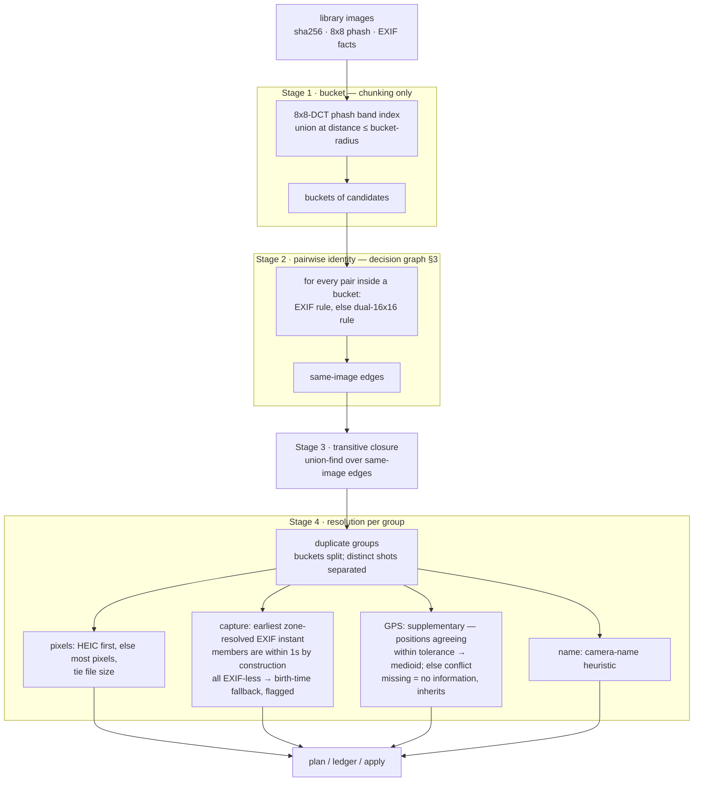
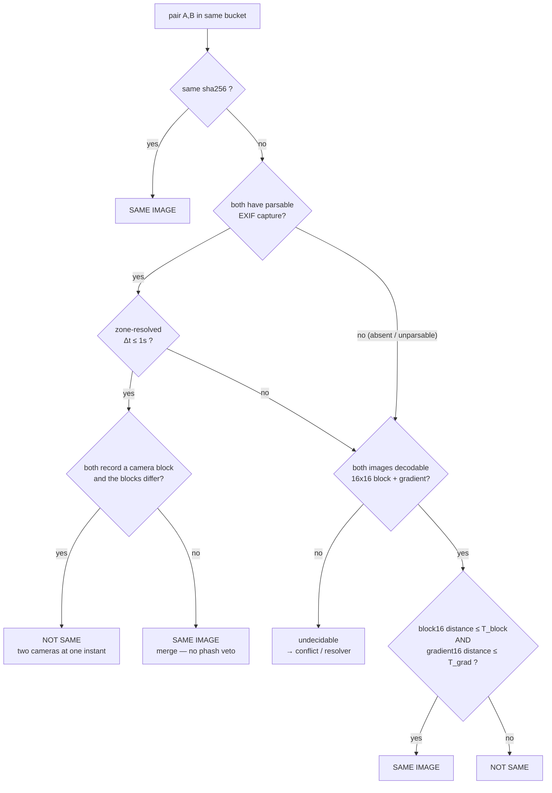

# Decision Graph — duplicate identity & group resolution

Status: **implemented** (2026-11-03, `internal/group/identity_exif.go` +
`group.go`). Approved spec drift from `.manual/chapter-02-semantics.md`
§2.3/§4.5: EXIF capture time is the first-order identity of a duplicate;
perceptual hashes are the fallback. Supersedes the ≥2-EXIF spread rule
(`--max-capture-disagreement`) and the near-identical conflict rule
(`--conflict-hamming`). The 2026-11-03 review removed the EXIF veto
(§1.3) and added the camera-block check; a corpus pass then re-enabled zone
inheritance and switched the EXIF-less birth guess to `min(creation,
modification)` — the pair rule is now: sha256, *or* same instant from the
same camera, *or* the dual-hash gate.

## 1. Principles

1. **Bucketing is chunking, not identity.** 8×8-DCT phash (current 128-bit
   hash) clusters candidates into small chunks; membership in a chunk says
   "worth comparing", nothing more.
2. **EXIF is identity of first order.** Two members whose *zone-resolved*
   capture instants differ by ≤ **1 second** captured the same moment —
   the scene cannot meaningfully change in 1 s — so they are the *same
   image* regardless of phash distance, unless both record *camera
   blocks* (EXIF Make + Model) that differ: two cameras firing at one
   instant are two pictures.
3. **EXIF mismatch is no veto.** Two members with parsable EXIF Δt > 1 s
   apart fall through to the dual-hash gate like any other pair: a
   re-export that lost its EXIF and regained a shifted timestamp must
   still be able to merge on hashes.
4. **No EXIF → dual image identity.** When a member lacks usable EXIF,
   identity falls back to *two* complementary 16×16 perceptual hashes —
   a **block** hash (coarse luminance blocks) and a **gradient** hash
   (edge/direction structure). A pair is the same image only if **both**
   distances pass, each under its own threshold (block tolerant of color
   and scaling; gradient tolerant of recompression; the conjunction is
   strict).
5. **Matching is transitive.** Same-image edges get a transitive closure —
   the goal is to *collect all duplicates*, so A~B and B~C put A, B, C in
   one group even when A~C alone would fail (chain drift is accepted;
   see §6).

## 2. Flow atop the library



Note the structural change from today: **buckets are not groups**. A
bucket may split into several groups (burst frames separate), and Stage 3
closure operates on same-image edges, not on bucket membership.

## 3. Pair decision graph

Zone resolution: every member is parsed against **its own** recorded
offset. When exactly one side records an offset, the other inherits it — a
missing zone is no information, and a pair was shot in one place — so their
wall clocks compare on the same zone. Two *known* offsets compare as instants
directly (equal instants across zones are the same moment); two unknown ones
compare wall clocks. The "offsets differ" conflict disappears.



Mixing cases: an EXIF member paired with an EXIF-less member takes the
dual-hash branch (the EXIF-less side has no instant to compare). When the
hashes pass, the pair merges and the **EXIF side donates capture time**
(and GPS) to the group.

## 4. Formal rule (pairwise, within one bucket)

Let `cam(X)` = camera block (Make + Model), `dB` = block16 Hamming, `dG` =
gradient16 Hamming. `inst(X)` is X's EXIF wall clock under offset `o(X)`; in a
pair, an empty `o` inherits the partner's when the partner records one (zone
inheritance), and two empty offsets both read as UTC wall clock.
`Δt = |inst(A) − inst(B)|`.

```
same(A,B) ≜
  sha256(A) = sha256(B) ≠ ∅          : true
  both EXIF, Δt ≤ 1s, ¬camConflict  : true
  both EXIF, Δt ≤ 1s, camConflict   : false
  otherwise (incl. Δt > 1s)          : dB ≤ T_block ∧ dG ≤ T_grad

camConflict(A,B) ≜ cam(A) ≠ ∅ ∧ cam(B) ≠ ∅ ∧ cam(A) ≠ cam(B)
```

Groups = connected components of `same` restricted to bucket edges.
Resolution then runs per component (pixels/capture/GPS/name as in §2).

## 5. What this replaces in current code

| Current | Fate |
|---|---|
| `Aggregate` union on phash ≤ maxHamming *is* the group | stays, demoted to bucketing (Stage 1) |
| `resolveMultipleEXIF` spread rule, `--max-capture-disagreement` 10s | replaced by pairwise Δt ≤ 1s |
| "EXIF timezone offsets differ" conflict | gone — instants compared directly |
| "EXIF GPS positions differ" conflict | gone as veto — missing GPS inherits; differing GPS is supplementary: within tolerance → medioid, beyond → conflict (group still applies, §6) |
| `nearIdenticalPair` / `--conflict-hamming` conflict rule | **removed** — it conflicted exactly what §3 merges (d 1–2, Δt 0) |
| `captureTolerance` 5s birth-vs-EXIF conflict | kept as a data-quality conflict (never a split — the group still applies) and extended: a member *without* EXIF whose file predates the group's earliest EXIF capture time by more than 5 s also conflicts |
| unparsable EXIF → conflict | falls to dual-hash branch; conflict only if also undecodable |
| 16×16 block/gradient hashes | **new** — computed lazily, only for EXIF-less files; needs storage (columns or hash table) + decoder coverage |

## 6. Accepted consequences

- Burst frames ≤ 1 s apart merge (scene ≈ unchanged — by definition).
- Two cameras firing at the same instant merge **only while at least one
  side records no camera block**; distinct recorded Make/Model split the
  pair (§1.2).
- Transitive chains can drift: A(12:00:00.0)~B(12:00:00.8)~C(12:00:01.6)
  merges A with C although Δt(A,C) > 1s. Accepted — collecting *all*
  duplicates wins.

## 7. Decisions (2026-10-29, user; extended 2026-11-03)

- **Window & flags** (Q4): pairwise same-image window default **1 s**;
  `--max-capture-disagreement` → `--same-image-window`, `--conflict-hamming`
  removed. Accepted.
- **GPS is supplementary** (Q3): never an identity veto. Within a resolved
  group, positions that agree within tolerance collapse to their
  **medioid**; positions that disagree beyond tolerance → **conflict**.
- **Conflict policy** (Q5): undecodable + no-EXIF pairs, and any conflict,
  **never drop the group** — apply materializes all members ("keep both")
  and records the conflict in the ledger/report. This also resolves the
  spec §2.3 vs code divergence found in the design review.
- **Thresholds** (Q1): no hand-picked values. czkawka's single-hash gate
  (64-bit, threshold ≈10) is not transferable to a 256-bit dual-gate
  conjunction and is precisely what produced its silent false positives.
  Calibration plan: label corpus pairs *by the EXIF rule itself*
  (zone-resolved Δt ≤ 1s ⇒ same image; burst-adjacent ⇒ different),
  compute block16/gradient16 distance distributions over positives and
  negatives, set T_block / T_grad at the separation. Run and report before
  wiring defaults.

- **2026-11-03 review** (user, implemented):
  - **No EXIF veto** — Δt > 1 s falls to the hash gate instead of
    forbidding the merge; only two rule changes beyond the hash gate:
    a recorded camera-block mismatch at Δt ≤ 1 s splits, and sha256
    equality always merges.
  - **Camera block** = EXIF Make + Model, stored per image
    (`images.exif_camera`); an empty block never vetoes.
  - **Zone inheritance (re-enabled)** — a member with an unknown offset
    inherits its partner's known zone (and the group's single known zone in
    resolution). The review removed this, but the corpus showed four
    identities split only for a missing `OffsetTimeOriginal`, so it is back;
    the re-run added no false merge.
  - **Birth-time conflicts extended** — an EXIF-less member created more
    than 5 s before the group's earliest EXIF capture time conflicts. The
    file birth guess is now `min(creation, modification)` time, so a copy
    that keeps its original's older mtime is not credited with its later
    copy moment.
  - **Pixel winner prefers HEIC** (original container), then most pixels,
    then larger file. Capture winner unchanged: earliest zone-resolved
    EXIF instant, else earliest creation time (flagged).
  - Increment uses the same pair rule: bucket proximity alone never
    joins a library group. The chunking flag is `--max-hamming-chunking`.
  - **Rotation / resolution hashing (evaluated, not done).** The corpus has
    **no** EXIF Orientation tag, so hashing after the indicated rotation
    would change nothing (and needs no extra decode — the image is already
    decoded fully). Pixel-rotated copies (a 90° re-save, blk 160 → 0 under a
    manual rotate) carry no tag to honour; they now merge via zone
    inheritance. Resolution is a non-issue: both 16×16 hashes are
    resolution-normalised (blockhash averages whole-image blocks, gradient
    lanczos-resizes), measured identical at 3072 px → 120 px, so a
    smallest-common-size retry can only lose information.

## 8. Candidate generation (implemented)

Bucket-only recall ceiling: Stage 2 only sees pairs inside a bucket
(8×8 distance ≤ radius), so a same-EXIF pair whose 8×8 hash drifted past
the radius — extreme downscale + color grade, exactly the case §1.2 says
must still merge — is never compared and silently stays unmerged.

**Implemented fix — timestamp candidate path:** EXIF-bearing members also
enter a candidate index keyed by zone-resolved instant (sort + sweep,
candidates within the window, O(n log n)), so an EXIF-rule pair whose 8×8
hash drifted past the bucket radius is still compared. Hash buckets remain
the candidate source only for the EXIF-less fallback, which is their
proper role. Unknown-offset members are indexed at their wall clock in the
sweep (zone inheritance happens at comparison, and a drifted pair that misses
the sweep is still recalled by its hash bucket); hash buckets stay the second
opinion for those pairs.
