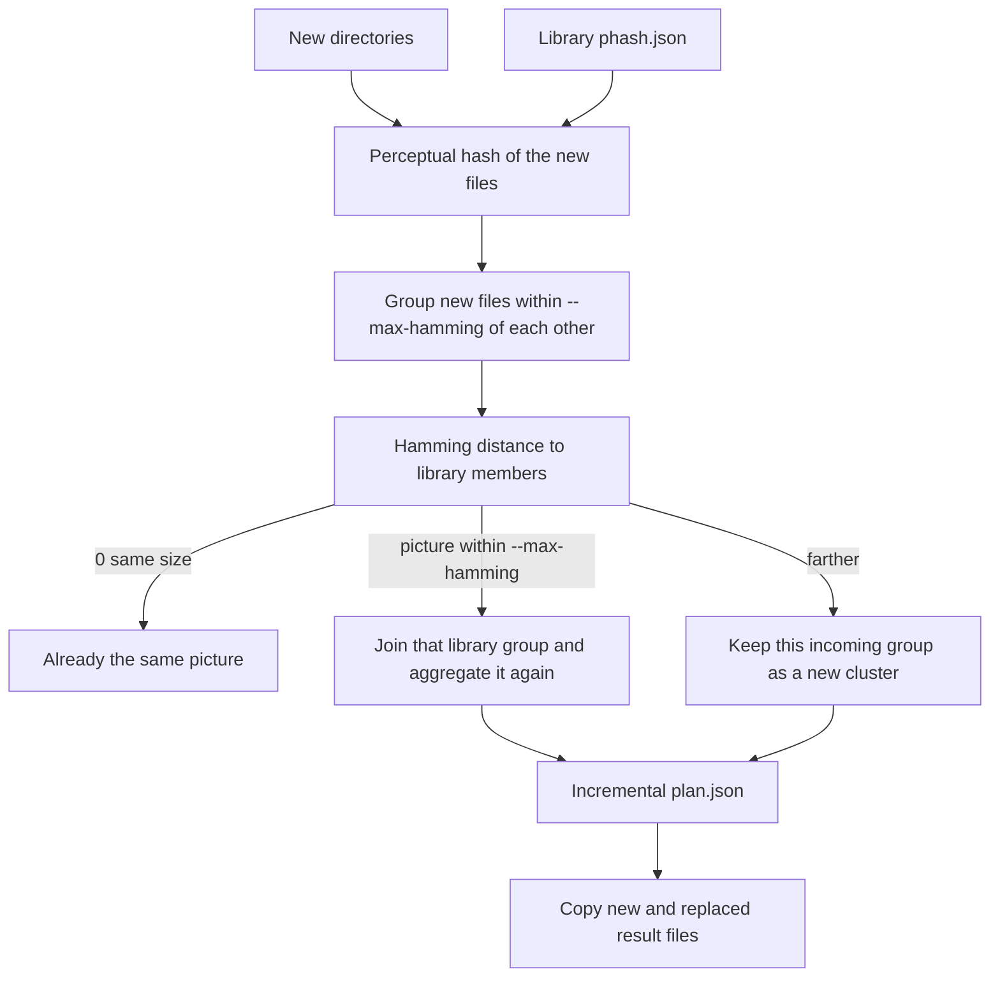

# Incremental library

Add photos to a library that already has `work/phash.json`, `work/clusters.json`, and `work/plan.json`. Each new photo is decoded once. That perceptual hash is its identity. The library is not hashed again and not clustered again.



The cost of the hash itself is planned in `docs/speed.md`: one oriented preview, cached by path, size, and modification time, with no SHA-256 pass.

## Command

```text
python repair_library.py increment \
  --library-work work \
  --dir INBOX --dir MORE \
  --work work-increment \
  --max-hamming 12 \
  --min-size 100
```

`--library-work` is read only. `--work` receives the incremental files. A later `apply --work work-increment --result LIBRARY` writes into the existing result directory.

## Step 1. Hash the new files once

Scan the new directories, including `--min-size`. Skip a file whose path, size, and modification time are already in `library-work/phash.json` or in the incremental cache. Hash the others after EXIF orientation. Store path, size, modification time, width, height, and the 256-bit hash in `work-increment/phash.json`.

Among the new files, distance 0 and the same size keeps the earliest path. The later path is `dropped`.

Files still kept are then grouped among themselves. Two hashes within `--max-hamming`, including a chain of such pairs, are one incoming picture. That grouping happens before the library comparison, so near-copies in the inbox become one picture even when one of them is close to the library and another is farther away.

## Step 2. Identity against the library

Load member hashes from `library-work/clusters.json`. Compare each incoming picture with those members.

| Distance from the closest file in the picture to the closest library member | Result |
| --- | --- |
| 0, and the same file size | That file is `present`. The same displayed picture is already in the library. |
| 0 at a different size, or 1 to `--max-hamming` | The whole incoming picture joins that library group. Exact copies in the picture stay `present`. |
| Greater than `--max-hamming` | The picture is new. Its files stay together as one cluster. |

Distance is to the members, not only the medoid. If two groups are both close enough, the picture joins the smaller distance. Equal distances join the lower group id and the group is marked `matches more than one library group`.

`work-increment/matched.json` records each joined file: path, library group id, matched member path, and distance.

## Step 3. New pictures are already clustered

A picture that did not meet the library is one cluster. It is not passed through HDBSCAN. The hashes from step 1 are reused.

Each new cluster gets a group id above the highest id in the library plan. A single unmatched photo is a one-image cluster.

## Step 4. Incremental plan

`work-increment/plan.json` has three kinds of rows.

| Row | How it is built |
| --- | --- |
| Untouched library group | Copied from `library-work/plan.json`. |
| Library group that gained files | Old members plus the joined files. Aggregation runs again. Group id stays the same. |
| New cluster | Aggregated from its own members. New group id. |

`changed` is true when the chosen pixel source or stored name differs from the library plan.

## Step 5. Apply

- Untouched rows are not copied again.
- A new group is copied, or moved when `--move` is set.
- A touched group whose chosen pixel file changed replaces that result file.
- `present` and `dropped` are not written.

## Files

| File | Contents |
| --- | --- |
| `phash.json` | Hashes of the new files, keyed by path, size, and modification time. |
| `unique.json` | Kept new files, `dropped` later copies, and `present` library matches at distance 0. |
| `matched.json` | New files joined to a library group. |
| `clusters.json` | Untouched library clusters, updated library clusters, and clusters of unmatched files. |
| `plan.json` | Library plan with touched groups replaced and new groups appended. |
| `clustering.json` | Parameters used for the unmatched files. |
